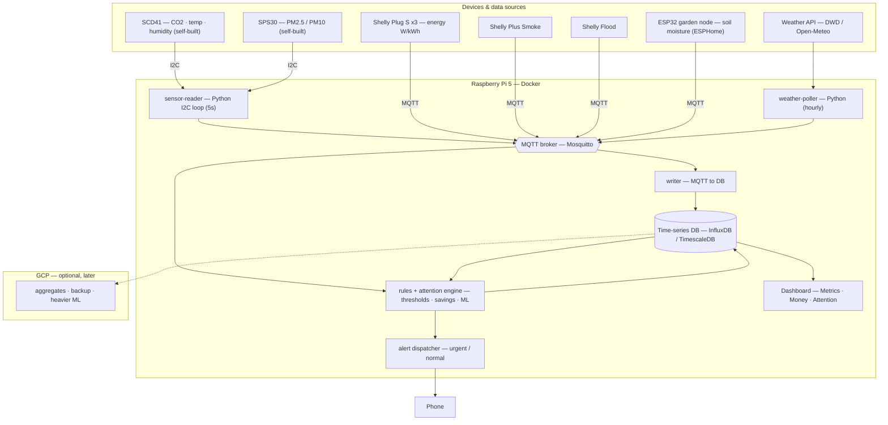

# Architecture

> v1 design. Everything runs locally on the Raspberry Pi in Docker. GCP is optional
> and only for later (aggregates / backup / heavier ML). Nothing here depends on a
> cloud account to function.

## System diagram



## Data flow, in words

1. **Collect.** Two paths converge on one MQTT bus:
   - Self-built sensors (SCD41, SPS30) are wired to the Pi's I²C pins; a Python
     `sensor-reader` polls them every ~5 s and publishes readings to MQTT.
   - Shelly devices (plugs, smoke, flood) and the ESP32 garden node publish to the
     same broker over WiFi. A `weather-poller` fetches DWD/Open-Meteo and publishes too.
2. **Store.** A `writer` subscribes to all topics and appends to the time-series DB.
3. **Decide.** The `rules + attention engine` reads live MQTT (fast alerts) and the DB
   (trends/savings), and writes derived results back — the Attention list, € savings,
   washing-done, mold risk, heating-failure, watering recommendation.
4. **Show & notify.** The dashboard reads the DB and renders the three views
   (Metrics / Money / Attention). The alert dispatcher sends urgent (safety) and
   normal (everything else) notifications to the phone.

## Why this shape

- **One MQTT bus** = every device and service speaks the same way; adding a sensor
  later is just another topic. No per-device special-casing.
- **DB in the middle** = history and trends come for free; dashboard and ML read one store.
- **Rules engine separate from dashboard** = alerts fire even when no screen is open.
- **Local-first** = keeps working without internet; GCP is an optional add-on.

## Planned repo layout (code comes after this design is approved)

```
home-observability/
├── README.md
├── docs/
│   ├── requirements.md      # use cases + acceptance criteria
│   └── architecture.md      # this file
├── services/
│   ├── sensor-reader/       # Python I2C → MQTT
│   ├── weather-poller/      # API → MQTT
│   ├── writer/              # MQTT → DB
│   ├── rules-engine/        # alerts, attention, savings
│   └── dashboard/           # the three views
├── infra/
│   └── docker-compose.yml   # broker + DB + services
├── .env.example
└── .gitignore
```

## Open choices (decide during the software phase, not now)

- Time-series DB: **InfluxDB** vs **TimescaleDB (Postgres)**.
- Dashboard: **Grafana** (fast, prebuilt) vs **custom app** (full control of the 3 views).
- Phone channel: **ntfy** (self-hosted, simple) vs **Telegram bot** vs **Pushover**.
