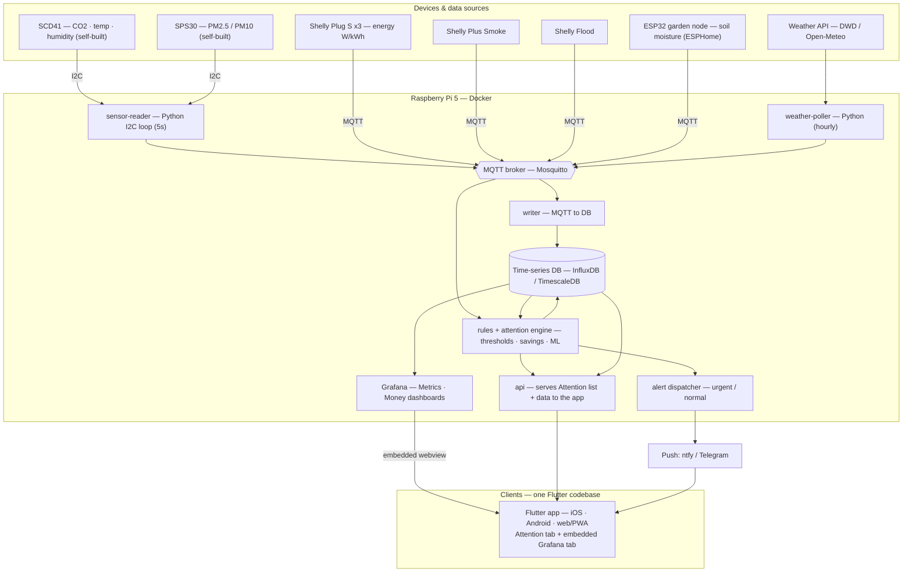

# Architecture

> v1 design. Everything runs locally on the Raspberry Pi in Docker. No cloud — the
> platform is fully self-contained and keeps working without internet.

## System diagram



## Data flow, in words

1. **Collect.** Two paths converge on one MQTT bus:
   - Self-built sensors (SCD41, SPS30) are wired to the Pi's I²C pins; a Python
     `sensor-reader` polls them every ~5 s and publishes readings to MQTT.
   - Shelly devices (plugs, smoke, flood) and the ESP32 garden node publish to the
     same broker over WiFi. A `weather-poller` fetches DWD/Open-Meteo and publishes too.
2. **Store.** A `writer` subscribes to all topics and appends to the time-series DB.
3. **Decide.** The `rules + attention engine` reads live MQTT (fast alerts) and the DB
   (trends/savings), and writes derived results back — the Attention list, € savings,
   washing-done, mold risk, heating-failure, watering recommendation.
4. **Show & notify.**
   - **Grafana** renders the Metrics + Money dashboards straight from the DB.
   - A small **`api`** serves the Attention list (and data) to the **Flutter app**, which
     has one codebase for iOS, Android, and web/PWA: an **Attention tab** (custom UI) and a
     **Dashboards tab** that embeds Grafana in a webview.
   - The **alert dispatcher** pushes urgent (safety) and normal notifications via a push
     service (**ntfy** or **Telegram**) to both phones — no app-store account needed.

## Clients & distribution

- **One Flutter codebase → iOS + Android + web.** Covers both phones (iOS + Android) and a
  browser view from the same source.
- **Dashboards tab** = Grafana embedded via webview (don't rebuild charts).
  **Attention tab** = custom UI, the part worth building by hand.
- **App stores are optional.** For a two-person household the simplest path is a
  **PWA** (Flutter web, hosted on the Pi, "add to home screen") plus **ntfy/Telegram for
  push** — their apps are already in both stores, so notifications work cross-platform
  without an Apple Developer account. A native build/TestFlight is only worth it later if
  you want native push and polish (Android sideloads freely; iOS needs the $99/yr Apple
  Developer account for TestFlight or the store).

## Why this shape

- **One MQTT bus** = every device and service speaks the same way; adding a sensor
  later is just another topic. No per-device special-casing.
- **DB in the middle** = history and trends come for free; dashboard and ML read one store.
- **Rules engine separate from dashboard** = alerts fire even when no screen is open.
- **Local-first** = fully self-contained; no cloud dependency, keeps working offline.

## Data retention

Tiered, capped at **2 years** — enough for year-over-year seasonal comparison without
bloating the Pi's DB:

| Tier | Resolution | Kept for |
|------|-----------|----------|
| Raw | per-sample (~5 s) | 60–90 days |
| Mid | 1–5 min rollups | ~1 year |
| Long | hourly / daily rollups | 2 years |

Both InfluxDB and TimescaleDB implement this natively (retention policies +
continuous aggregates / downsampling tasks).

## Planned repo layout (code comes after this design is approved)

```
home-observability/
├── README.md
├── docs/
│   ├── requirements.md      # use cases + acceptance criteria
│   └── architecture.md      # this file
├── services/
│   ├── sensor-reader/       # Python I2C → MQTT
│   ├── weather-poller/      # API → MQTT
│   ├── writer/              # MQTT → DB
│   ├── rules-engine/        # alerts, attention, savings
│   └── api/                 # serves Attention list + data to the app
├── app/                     # Flutter app (iOS · Android · web)
├── infra/
│   ├── docker-compose.yml   # broker + DB + Grafana + services
│   └── grafana/             # provisioned dashboards (Metrics · Money)
├── .env.example
└── .gitignore
```

## Decided

- **Backend language:** Python for all Pi services (official SCD41/SPS30 drivers +
  pandas/scikit-learn for the Money/ML work; perf is a non-issue at this volume).
  The `writer` may be ported to Rust later as an optional, self-contained exercise.
- **Dashboards:** Grafana (Metrics + Money), provisioned as code, embedded in the app.
- **App:** Flutter — one codebase for iOS + Android + web; Attention tab (custom) +
  Dashboards tab (embedded Grafana). PWA first; app stores optional.
- **Push:** ntfy or Telegram (final pick in the software phase) — no store account needed.

## Open choices (decide during the software phase, not now)

- Time-series DB: **InfluxDB** vs **TimescaleDB (Postgres)**.
- Push service: **ntfy** (self-hosted, simple) vs **Telegram bot**.
